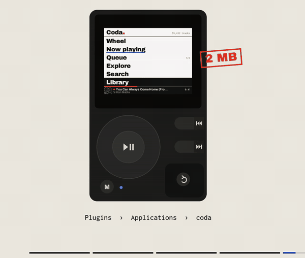
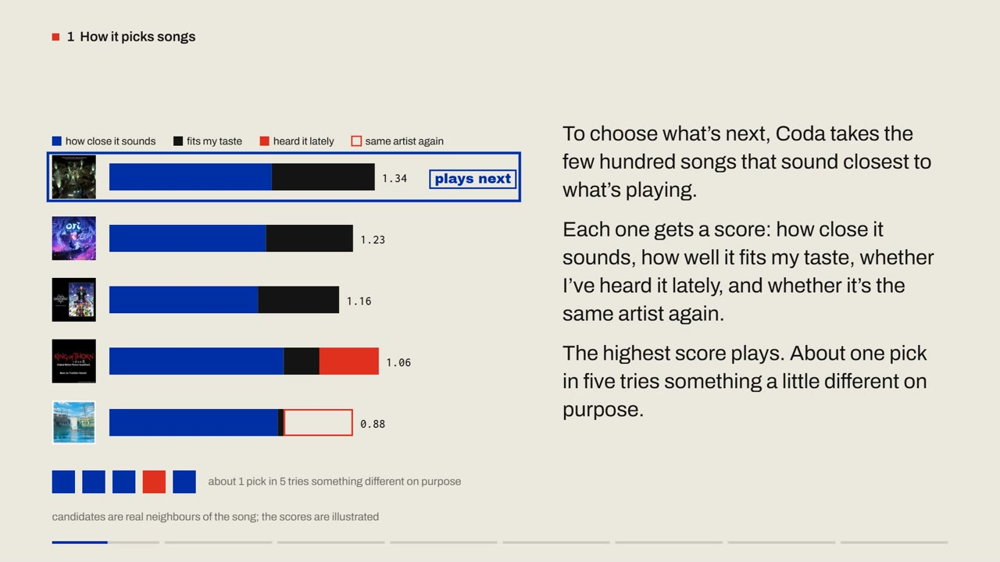
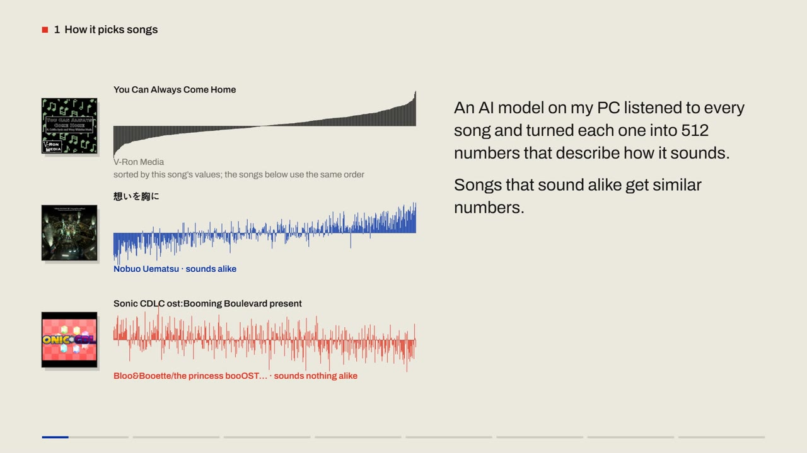
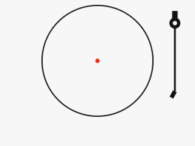
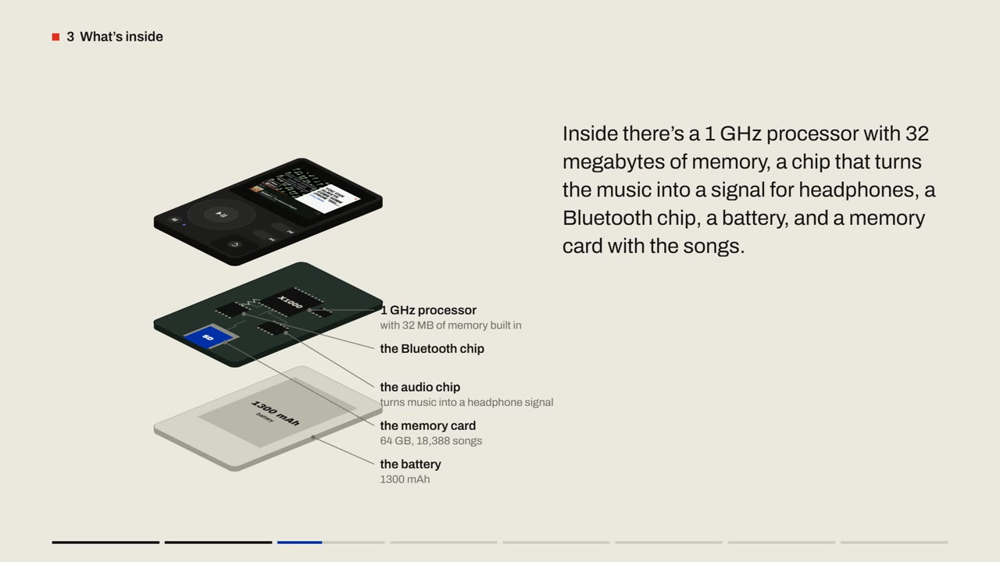
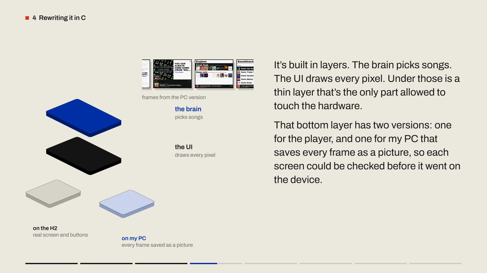
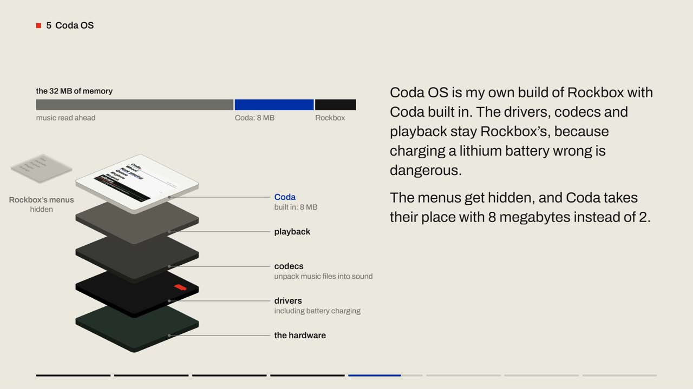
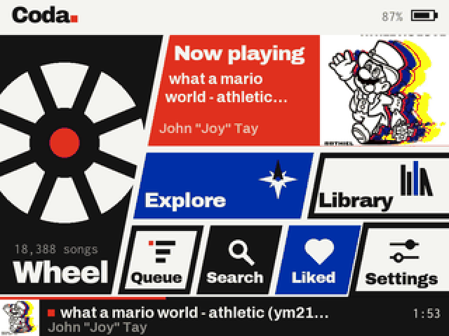
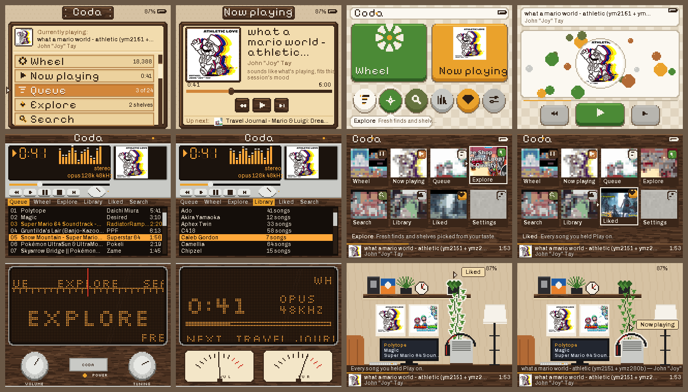
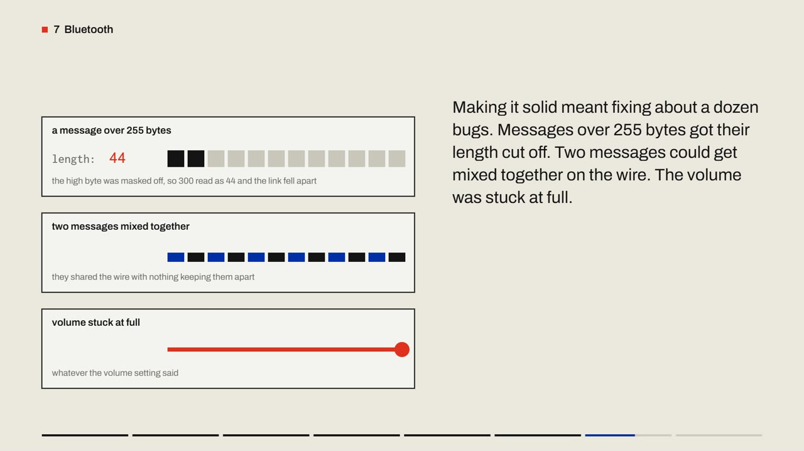

# Coda

An offline music player that picks the next song for me. It runs on my PC, and as its own
firmware on a $124 HiFi Walker H2.

[](docs/media/how-coda-works.mp4)

**[▶ Watch the film: How Coda works (5:52, with sound)](docs/media/how-coda-works.mp4)**

| | |
|---|---|
| **Library** | 42,850 songs downloaded from YouTube to match my taste |
| **Taste** | 10,941 YouTube Music listens, from Takeout exports |
| **Picking** | a 512-number sound fingerprint per song, plus a scored shortlist |
| **Device** | HiFi Walker H2 running Coda OS (Rockbox with Coda built in), 18,388 songs on a 64 GB card |
| **Code** | Python (library, engine), Svelte (web player), C (device, ~11k lines) |

## How it picks the next song



- **Fingerprints.** MuQ-MuLan listens to every song and returns 512 numbers. Songs that sound alike get similar numbers.
- **Shortlist, then score.** The few hundred songs closest to what's playing are scored on sound, taste, recent plays and artist repeats. About 1 pick in 5 explores on purpose.
- **Taste** comes from my YouTube Music history, not just plays inside the app.
- **Engine v3 (Oct 2026)** took out a direction every fingerprint shared. On 410 songs I found after late July, picking the liked one over a random song went from **54% to 67%**. Measurements: [`docs/EXPERIMENTS.md`](docs/EXPERIMENTS.md).



## The player: HiFi Walker H2

 

- **Why this one:** pocket-sized, real buttons and a scroll wheel, and it runs [Rockbox](https://www.rockbox.org), open-source player firmware. It's about the only player still being made that Rockbox supports.
- **Inside:** Ingenic X1000 (1 GHz, 32 MB of memory), ES9018K2M audio chip, CYW4343W Bluetooth chip, 1300 mAh battery, microSD.
- **Installing a system is copying a folder.** The bootloader starts whatever is in `/.rockbox` on the card. [`scripts/install_coda_os.py`](scripts/install_coda_os.py) swaps it, and `--revert` puts the old one back.

## Rewritten in C



- The web version needs a browser and Python. The H2 has neither, so Coda was rewritten in C ([`firmware/`](firmware)).
- **Layers:** the brain ([`firmware/core`](firmware/core)), the UI ([`firmware/ui`](firmware/ui)), and a thin hardware layer ([`firmware/plat`](firmware/plat)) with two versions. One runs on Rockbox. The other renders every screen to a PNG on the PC ([`docs/h2/c`](docs/h2/c)).
- **Fitting the hardware:** all drawing uses whole numbers, since decimal math is slow on the X1000. The library streams from the card because a Rockbox app gets 2 MB.
- **Same picks as the PC:** the C brain matches the Python one on all 86 test cases, random exploration included (`firmware/host/test_engine3`).

## Coda OS



- My own Rockbox build with Coda compiled in. It boots straight into Coda and has 8 MB instead of 2.
- Rockbox's drivers, codecs, playback and battery charging stay as they are. Its menus are hidden behind **Menu + Back**.
- Build: [`firmware/rockbox/os/`](firmware/rockbox/os). Plan and status: [`docs/H2_APP_PLAN.md`](docs/H2_APP_PLAN.md).

## Themes

 

- Every screen is drawn by Coda's own code. New looks start as mockups made with my real songs at 320×240 ([`firmware/tools/mock_*.py`](firmware/tools), [`docs/h2/`](docs/h2)).
- Picked so far: the grooves boot animation and the panel menu. A batch of pixel-art themes is next.

## Bluetooth (not confirmed on the hardware yet)



- Rockbox has no Bluetooth for the H2. This build starts from Skye Green's unmerged port and fixes about a dozen bugs in it ([`firmware/rockbox/bt/patches`](firmware/rockbox/bt/patches), [`docs/h2/BLUETOOTH.md`](docs/h2/BLUETOOTH.md)).
- First real test: pairing and connecting worked, but there was no sound. The Bluetooth volume was never set, so every sample was multiplied by zero. That's fixed and waiting on a retest.

## What's next

- A 256 GB card for the whole library.
- Plays sync from the H2 back to the PC, so taste keeps updating.
- A build with Rockbox's menu code removed entirely (1,270 KB → 664 KB).

## Repo map

| folder | what's in it |
|---|---|
| [`scripts/`](scripts) | collection, library, the engine (`server.py`, `personalize.py`), evaluation |
| [`web/`](web) | the Svelte web player |
| [`firmware/`](firmware) | Coda in C, the Rockbox port, Coda OS, Bluetooth patches |
| [`docs/`](docs) | experiments, plans, device notes |
| [`viz/`](viz) | films and figures ([`viz/coda`](viz/coda) is the film above) |
| [`tests/`](tests) | pytest |

## Run the web player

```powershell
python -m venv .venv
.venv\Scripts\python -m pip install -r requirements.txt -r requirements-ml.txt   # GPU install order: see requirements-ml.txt
cd web; npm install; npm run build; cd ..
.venv\Scripts\python scripts\server.py      # http://127.0.0.1:5000
.venv\Scripts\python -m pytest -q
```

The library lives outside the repo (`D:\OfflineMusic`). `auth/`, `data/`, `music/` and `external/`
are gitignored: they hold credentials, personal data and clones.

<details>
<summary><b>All scripts</b></summary>

**Collection** (yt-dlp / ytmusicapi)
- `parse_takeout_history.py`: Takeout watch-history → frequency/recency-weighted seeds
- `merge_takeout.py`: folds a new Takeout export into the cumulative history (Google only exports ~7 months, so always merge)
- `setup_auth.py`: YT Music browser auth (cookie → `auth/browser.json`)
- `harvest_radios.py`: drains song radios → co-occurrence-ranked candidates
- `harvest_playlists.py`: mines public playlists your songs appear in, ranked by `curated_freq`
- `build_queue.py`: merges radio and playlist candidates → `data/unified_candidates.csv`
- `curate.py`: version-preserving dedupe + artist caps + genre caps → `data/download_queue.csv`
- `download_tracks.py`: download + clean tags + search fallback; resumable, 403/429 backoff
- `scan_loudness.py`: EBU R128 scan → `R128_TRACK_GAIN` tags (the player normalizes to −14 LUFS, attenuate-only)

**Curation / labeling**
- `llm_prep.py` / `llm_merge.py`: LLM VGM/series classification of titles → `data/llm_series.csv`
- `label_artists.py` / `merge_artist_genre.py`: artist genre labels (feed genre caps)

**Algorithm / analysis**
- `muq_run.py`: incremental MuQ-MuLan embedding (GPU) → `data/muq_embeddings.npz`
- `build_salience_index.py` / `deep_salience.py` / `hum_search.py`: hum-to-search v2 (polyphonic melody salience + GPU local alignment, `POST /api/hum`); re-run the build after downloads, it only indexes new tracks
- `build_melody_index.py` / `melody_match.py` / `eval_hum.py`: hum-to-search v1 (CREPE + DTW), the fallback when there's no salience index or no GPU
- `eval_methods.py`: collaborative method benchmark (recall@K, MRR, nDCG)
- `eval_autoplay.py`: autoplay measurement (`sim`, `replay`, `taste` holdout)
- `autoplay.py`: hybrid autoplay from the command line (`--text "mood"` or `--seed-contains "track"`)
- `genre_map.py` / `vgm_space.py`: genre map and VGM sub-space → `viz/`
- `tune_autoplay.py`, `visualize.py`, `make_playlists.py`, `dl_bench.py`, `analyze_playlists.py`

**Device**
- `export_h2.py`: picks the songs for the card, copies them with small covers and loudness tags, writes the device pack
- `install_coda_os.py`: installs or reverts Coda OS on the card
- `h2_sync.py`: pulls the H2's play log back into the PC's `plays` table

**Suite**
- `run_all.py`: every embed + eval + map + playlist + tune + figure + test → `docs/REPORT.md`

</details>
